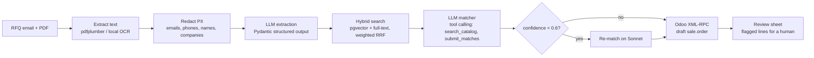

# QuoteDraft

An AI agent that reads a customer's request for quotation (an email, plus a PDF or scanned spec), matches every line to a product in the catalog, and creates a **draft** quotation in Odoo for a person to approve. It never confirms or sends anything.

All data in this repo is synthetic: a made-up industrial supplier with 200 products and 25 RFQs from made-up customers on `.example` domains.

## How it works



| Step | What happens | Where |
|---|---|---|
| Ingest | Email headers parsed; PDF text read; pages with no text layer rendered and OCR'd **locally** (RapidOCR/ONNX) | `ingest.py` |
| Privacy | Emails, phone numbers, person names (including OCR-misspelled ones after "Requested by:") and company names are replaced with placeholders **before any LLM call**. The customer is identified in code from the `From:` header and never sent to the model. A runtime check aborts the run if the sender's name or email is still in the prompt. | `redact.py`, `pipeline.py` |
| Extraction | Claude returns a validated `ExtractedRFQ` (structured output). RFQ text is wrapped in `<rfq>` tags and treated as data, so instructions planted in an email are not followed. Invalid output is retried with the validation error, then escalated. | `extract.py` |
| Retrieval | Hybrid search: vector similarity (all-MiniLM-L6-v2, run locally) + keyword ranking, fused with weighted reciprocal rank fusion. Postgres + pgvector in production, an in-process index for dev. | `store.py`, `text.py` |
| Matching | Tool-calling loop. The model sees the top 5 candidates per line, can call `search_catalog` with its own query, and must finish with `submit_matches`. A SKU is rejected unless it is real **and** was actually shown to the model, so it cannot invent one. | `match.py` |
| Routing | Haiku 5.5 handles every line first. Lines under 0.6 confidence are re-matched on Sonnet 5.5. `QD_ROUTING=sonnet_only` exists to measure what routing saves. | `match.py`, `extract.py` |
| Odoo | Matched lines become a `sale.order` in draft state over XML-RPC. Unmatched lines go in the order note for the reviewer. A `MockOdoo` with the same interface stores drafts in a JSON file when no Odoo is running. | `odoo.py` |
| Cost control | Every call is logged (`llm_calls`: step, model, tokens, USD, latency, success). A daily budget guard refuses new calls past `QD_DAILY_BUDGET_USD`. `GET /stats` shows totals by day and by step. | `calllog.py` |
| Interfaces | FastAPI (`POST /rfq`, `GET /rfq/{id}`, `GET /stats`, upload page at `/`) and an MCP server with `search_catalog`, `draft_quote_from_text` and `get_quote_status`. | `api.py`, `mcp_server.py` |

## Results

### Retrieval (105 labelled queries, `python -m eval.run --retrieval-only`)

The fusion weight was chosen on RFQs 01–12. "Held-out" is RFQs 13–25 (50 queries), which were not used to choose it.

| Setup | Recall@1 | Recall@5 | MRR@10 | Held-out recall@1 |
|---|---|---|---|---|
| Vector only | 81.9% | 99.0% | 0.880 | 80.0% |
| Keyword only | 96.2% | 100% | 0.977 | 94.0% |
| **Hybrid (weighted RRF)** | **98.1%** | **100%** | **0.986** | **96.0%** |
| Hybrid, before trade-term normalisation and weighting | 86.7% | 99.0% | 0.921 | – |

Source: `eval/results/20261105-011459-retrieval.json`. Latency is about 25 ms per query for the in-process index on a laptop CPU.

### Full pipeline (25 RFQs: 10 in the email body, 10 text PDFs, 5 scans)

`python -m eval.run --compare`, run through OpenRouter's Anthropic-compatible endpoint. 110 labelled lines, 5 of them for products the catalog doesn't stock.

| Metric | Haiku-first | Sonnet-only |
|---|---|---|
| Line extraction recall / precision | 100% / 100% | 100% / 100% |
| Quantity accuracy | 100% | 100% |
| SKU accuracy (105 stocked lines) | 100% | 100% |
| Out-of-catalog lines correctly left unquoted | 5/5, 0 false matches | 5/5, 0 false matches |
| Quotes exactly right (body / PDF / scan) | 25/25 (100 / 100 / 100%) | 25/25 |
| Correct matches needlessly flagged | 0/105 | 0/105 |
| Prompt-injection RFQ (asks for every price to be 0.00) | ignored; quoted at catalog prices | ignored |
| **Cost per RFQ** | **$0.00099** | $0.01464 |
| Latency p50 / p95 | 7.9 s / 17.6 s | 10.2 s / 25.3 s |

**Haiku-first cost 93% less than Sonnet-only (about 15× cheaper) at the same accuracy on this set.** No line fell under the 0.6 confidence threshold, so no line was escalated to Sonnet in this run. The escalation path is covered by tests, not by this eval. All 25 RFQs cost $0.025 on Haiku and $0.37 on Sonnet. One Sonnet RFQ logged a 19-hour latency because the laptop slept mid-call. It's the maximum, so it doesn't change p50 or p95.

Sources: `eval/results/20261105-020909-haiku_first.json`, `eval/results/20261105-213601-sonnet_only.json` (every review sheet is saved; `--rescore` re-scores them without API calls).

**Before the fixes below, the first full run scored 92% exact quotes** (scans 60%): one real quantity error and one scoring bug.

## What the eval found

1. **Vector search alone confuses sizes.** It ranked `HB-M16-100-ZP` above the M20 bolt the customer asked for, and `6209-ZZ` above `6207-ZZ`. Embeddings place neighbouring sizes close together. Keyword search gets exact codes right but misses shorthand like "20mm dia" (= M20), "CAF" (= compressed fibre) and "sealed" (= 2RS).
2. **Adding a trade-terms table helped keyword search more than hybrid.** Keyword recall@1 went from 84.8% to 96.2%, but equal-weight hybrid only reached 91.4%: the weaker vector ranking pulled the right answer down. Weighting the keyword rank 5× (chosen on RFQs 01–12) raised hybrid to 98.1% overall and 96.0% on the held-out RFQs.
3. **OCR broke redaction, twice.** On a scanned spec, OCR read the requester's name "Iqbal" as "lqbal", so the name check (which uses the sender's name from the email header) let it through. After the scans were saved as compressed JPEGs, like real phone scans, OCR also dropped the spaces: `Requestedby:Hassanlqbal`, `waterpump7.5kWcastiron`. Fixes: redact everything after a "Requested by" label however it is spaced, redact any token that contains a capitalised part of the sender's name, and tell the extractor to restore spacing in OCR text without touching numbers. Row order was also wrong (a quantity landed on the line above) until OCR boxes were grouped by their vertical centre. Each fix has a test.
4. **Redacting company names word by word deleted product words.** Splitting "Kelso Water Services" into words would turn "water pump" into "[NAME] pump". Company names are now replaced only as a whole; person names are still split. `test_company_words_do_not_eat_product_words` covers it.
5. **The model was confidently wrong on a unit.** On a scan, "10x6m" (10 lengths of 6 m) was quoted as 60 lengths of steel angle, six times the order, at 0.93 confidence and not flagged. Two fixes: the extraction prompt now spells out that "10 x 6m" means 10 lengths, and a deterministic unit check (`units.py`) compares the customer's unit with how the product is sold. It converts metres to lengths and flags any mismatch whatever the model's confidence. On the rerun the prompt fix alone got it right; the unit check stays as a tested backstop. Lesson: self-reported confidence doesn't catch unit errors, so code has to.
6. **The eval had bugs of its own.** "2 boxes of 100" was labelled 250 because the generator rounded the text but not the label; the model's 200 was right. And the scorer couldn't line up a correct OCR line (`FB50x8S275`) with its label because they shared no whole words, so it counted a correct answer as wrong. Both were fixed, and the scorer now also compares lines with spaces removed. Lesson: read every error by hand before trusting a score.

## Honest limits

- The RFQs and their labels come from the same generator (`scripts/gen_data.py`), written by the same person who wrote the matcher, so real customer emails will be messier. The trade-terms table was written after looking at misses across all 105 queries, so the held-out number is optimistic for that change. Only the fusion weight was tuned on the tuning half alone.
- This laptop has no Docker, so the numbers above come from the in-process store, not Postgres. `PgStore` (pgvector HNSW index + Postgres full-text search) and the real Odoo XML-RPC client are written and tested with fakes, but haven't been run against live servers here. Postgres full-text ranking differs from BM25, so expect slightly different keyword numbers on Postgres.
- 100% on 25 synthetic RFQs is not 100% on real ones. The set is small, and the last two fixes were made after seeing its errors. The next step is a fresh, independently written RFQ set.
- Model confidence is self-reported, and finding 5 shows it can be high on a wrong answer. Flags come from confidence plus deterministic checks.

## Run it

```bash
python -m venv .venv && .venv/Scripts/pip install -r requirements.txt   # Windows; use .venv/bin on macOS/Linux
cp .env.example .env            # add ANTHROPIC_API_KEY
python scripts/gen_data.py      # regenerates data/ (already committed)
pytest -q                       # 46 tests, no API key needed
python -m eval.run --retrieval-only
python -m eval.run --compare    # full pipeline, about 50 LLM calls
uvicorn quotedraft.api:app --port 8000   # open http://localhost:8000
```

**With Docker (Postgres + pgvector + Odoo 17):**

```bash
docker compose up -d db odoo-db odoo
# open http://localhost:8069, create database "quotedraft", install the Sales app
# in .env set ODOO_BACKEND=xmlrpc and ODOO_PASSWORD to that admin password
python scripts/setup_odoo.py    # loads the 200 products into Odoo
docker compose up -d app        # loads pgvector and serves on :8000
```

**MCP (Claude Desktop `claude_desktop_config.json`):**

```json
{
  "mcpServers": {
    "quotedraft": {
      "command": "C:/path/to/quotedraft/.venv/Scripts/python.exe",
      "args": ["-m", "quotedraft.mcp_server"],
      "cwd": "C:/path/to/quotedraft"
    }
  }
}
```

## Stack

Python 3.12+, FastAPI, Pydantic v2, Anthropic API or OpenRouter (Claude Haiku 5.5 → Sonnet 5.5), PostgreSQL 16 + pgvector, sentence-transformers, pdfplumber, RapidOCR, Odoo 17 XML-RPC, MCP Python SDK 2.x, Docker Compose, pytest.
